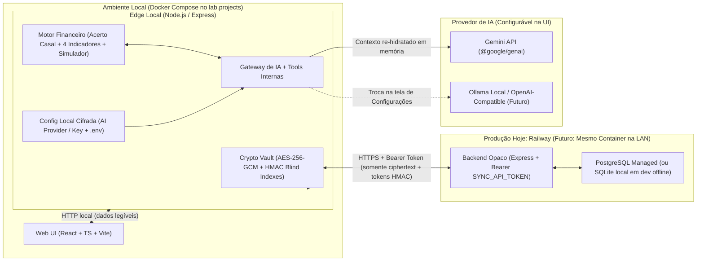

# Plano de Execução Consolidado — `apps/financas` (Local-First + Zero-Knowledge + IA)

Plano final consolidado para evoluir o antigo `apps/fatura-casal-csv-app` para **`apps/financas`** dentro do `lab.projects`.

---

## 1. Decisões Arquiteturais Definidas

| Dimensão | Decisão Confirmada |
| --- | --- |
| **Pasta e Identidade** | Renomear `apps/fatura-casal-csv-app` → `apps/financas` (via `git mv` preservando histórico), atualizando `docker-compose.yml` e Homepage (`financas.traefik.me` + alias `fatura.traefik.me`). |
| **Topologia Hoje** | **Híbrida desde o início**: UI + Edge Local rodando na máquina local via Docker Compose, conectados ao **Backend Opaco na Railway**. |
| **Privacidade (Zero-Knowledge)** | **Edge Local em Docker** guarda `LOCAL_MASTER_KEY` no `.env` local e cifra **tudo** (`AES-256-GCM`: textos, nomes, categorias, planos e valores) + tokens opacos (`HMAC-SHA256`) antes de enviar à Railway. O banco em produção não faz sentido algum fora do ambiente local. |
| **Banco & Auth do Backend** | Backend único em Node.js/Express com **PostgreSQL** (managed na Railway hoje; container Postgres no futuro homelab) + **modo SQLite opcional** para dev offline rápido, protegido por Bearer Token (`SYNC_API_TOKEN`). |
| **Frontend** | **React + TypeScript + Vite**, buildado e servido pelo Edge Local com `pdfjs-dist` local (zero CDNs externas). |
| **IA & Configurações** | **Tela de Configurações na UI** permitindo trocar provedor, modelo e API key (começando com **Gemini API** via `@google/genai`, pronto para OpenAI-compatible e Ollama local). Configuração/chave salva **apenas localmente no Edge Docker** (cifrada em volume local, fallback pro `.env`) — nunca sobe nem cifrada para a Railway. Chamadas de IA saem direto do Edge Local com tools internas próprias e zero sistemas externos. |
| **Faturas (Parser)** | Inicialmente **Itaú PDF** (refatorado em módulo compartilhado + extração de parcelas futuras), sob uma interface `BillParserAdapter` extensível para novos cartões no futuro. |
| **Conferência do Casal** | Suporta gastos pagos **por mim e por ela** (fatura + contas fixas/avulsas), divisão padrão **50/50** com opção de **proporção customizada** por item/regra e cálculo automático do **acerto líquido final** ("quem transfere quanto para quem"). |
| **Economias & Planos do Casal** | **Enxuto e sem atrito**: no check-in de fechamento mensal, campo simples de **"quanto guardamos juntos no mês"** + **lista livre em texto de planos do casal** que a IA leva em conta no planejamento pessoal (sem exigir metas numéricas rígidas). |
| **Fluxo de Caixa** | **Modelo enxuto**: receitas e contas fixas recorrentes auto-preenchidas todo mês + lançamento rápido de extras/avulsos relevantes + importação do PDF do cartão (sem precisar importar extrato bancário). |
| **Segurança Financeira** | Painel objetivo com **4 indicadores configuráveis**: (1) **Runway da reserva** em meses, (2) **Taxa de poupança mensal**, (3) **Comprometimento de renda** (fixos + parcelas) e (4) **Margem segura livre para compras**. |
| **Planejamento de Compras (IA)** | **Backlog de compras desejadas** (preço, urgência, escopo pessoal/casal) + **Perfil editável de interesses e planos** + **Simulador de impacto** (à vista ou parcelado) + **Chat/Botão de IA** que reordena prioridades e sugere quando comprar via tools internas. |
| **Futuro Servidor Local** | Tudo desenhado **Homelab-Ready** (LAN-only): sem CDNs, sem SaaS proprietário, `LAB_DOMAIN` configurável, bastando subir o mesmo container `backend` + `postgres` no servidor local e trocar a URL do Edge. |

---

## 2. Arquitetura do Sistema

---

## 3. Modelo de Dados (Domínio Local vs. Armazenamento Opaco)

No PostgreSQL da Railway, cada entidade é armazenada como um **envelope opaco** (`id`, `entity_type`, `period_key`, `blind_index`, `encrypted_payload`, `updated_at`, `deleted_at`), onde **todo conteúdo real** (descrição, apelido, categoria, valores, notas, planos) fica cifrado via `AES-256-GCM` pelo Edge Local.

Entidades de domínio descriptografadas apenas no Edge Local:
- `LabelRule` (estabelecimento normalizado -> apelido, categoria, escopo, % divisão)
- `MonthlyClosing` (competência `YYYY-MM`, status, totais, acerto líquido, quanto guardaram juntos no mês, snapshot de segurança)
- `Transaction` (fonte, pago por, data, descrição original, apelido, categoria, valor, escopo, %, parcela)
- `RecurringCashflow` (entradas/saídas recorrentes auto-preenchidas)
- `ReserveState` (reserva líquida, acumulado conjunto opcional, outros investimentos)
- `CouplePlanNote` (lista livre de planos do casal em texto)
- `UserProfile` (interesses, prioridades e metas dos 4 indicadores)
- `PlannedPurchase` (backlog de próximas compras + avaliação da IA)

---

## 4. Motor de Segurança Financeira (4 Indicadores Configuráveis)

Todos os cálculos rodam de forma **100% determinística** no `edge/`:
1. **Runway da Reserva (Meses)**: `Reserva Líquida ÷ Custo Mensal Base` (comparado contra meta configurável, padrão 6 meses).
2. **Taxa de Poupança Mensal (%)**: `(Poupança Individual + Minha Parte nas Economias Conjuntas) ÷ Renda Líquida Mensal`.
3. **Comprometimento de Renda (%)**: `(Fixos Individuais + Minha Cota dos Fixos do Casal + Parcelas Comprometidas) ÷ Renda Líquida Mensal`.
4. **Margem Segura Livre (R$/mês)**: `Renda − Fixos Individuais − Minha Cota do Casal − Parcelas Futuras − Aporte Mínimo da Meta de Poupança`.

---

## 5. Estratégia de Testes & Quality Gates (Zero Regressão)

- **Ferramentas**: `Vitest`, `supertest`, `@testing-library/react` + `jsdom`, `tsc --noEmit`, `vite build`.
- **Camadas obrigatórias**:
  1. **Unitários — Parser Itaú (`shared/parsers`)**: faturas sintéticas anonimizadas (nacional, internacional, dedup, filtros e **parcelas futuras**).
  2. **Unitários — Criptografia & Zero-Knowledge (`shared/crypto` + `edge/vault`)**: roundtrip `AES-256-GCM`, tamper detection, HMAC determinístico e **asserção de vazamento zero** inspecionando registros reais no banco.
  3. **Unitários — Motor Financeiro (`edge/financeEngine`)**: acerto líquido do casal, 4 indicadores e simulador de compras.
  4. **Integração — Edge ↔ Backend Opaco**: fluxo ponta-a-ponta contra SQLite in-memory + rejeição `401` sem `SYNC_API_TOKEN`.
  5. **Integração — Gateway de IA & Config Local**: `MockAIProvider` testando tools internas e garantindo que API keys nunca saiam do volume local.
  6. **UI & Smoke Build**: fluxo crítico em React + `npm run check` (`typecheck` + `test` + `build`) + validação Docker antes de commitar direto na `main` com a skill `.agents/skills/commit-phase/SKILL.md`.

---

## 6. Fases de Execução & Status

- **Fase 0** (`✅ Concluída`): Migração `fatura-casal-csv-app` → `apps/financas`, workspaces (`shared`, `web`, `edge`, `backend`), parser Itaú unificado com parcelas futuras + testes, UI React + TS + Vite sem CDNs e `Dockerfile.edge` no `docker-compose.yml`.
- **Fase 1** (`✅ Concluída`): Criptografia Zero-Knowledge (`shared/crypto`), `backend/` opaco (PostgreSQL + SQLite opcional + `SYNC_API_TOKEN`), `edge/vaultClient`, deploy na **Railway** e painel de Auditoria de Privacidade.
- **Fase 2** (`✅ Concluída`): Memória de Labels (`LABEL_RULE`), edição inline (apelido, categoria, `Individual`/`Casal`, % customizada) e aba `Labels Salvos`.
- **Fase 3** (`✅ Concluída`): Conferência Mensal do Casal (`YYYY-MM`), gastos pagos por mim e por ela, **acerto líquido final**, check-in guiado (economias conjuntas + lista livre de planos do casal) e aba `Histórico`.
- **Fase 4** (`✅ Concluída`): Fluxo de caixa enxuto (recorrentes + avulsos + parcelas futuras + reservas) e Dashboard dos **4 Indicadores de Segurança Financeira**.
- **Fase 5** (`✅ Concluída`): Tela de Configurações de IA 100% local (`Gemini` via `@google/genai` inicialmente, trocável na UI), organização assistida de faturas e página de **Planejamento de Próximas Compras** (backlog + perfil/interesses + simulador + chat/priorização com tools internas).
- **Fase 6** (`✅ Concluída`): Profiles `hybrid` / `local-offline` / `homelab` no `docker-compose.yml`, backup/restauração cifrada em 1 clique e suporte a `OllamaProvider` para autonomia total na rede local.
- **Melhorias Contínuas** (`✅ Concluída`): Máscara BRL (`CurrencyInput`), suporte Vertex AI Express Mode (`AQ.*`), herança automática de parcelas do mês anterior, pré-carregamento de contas fixas na conferência, Skeletons e estados de Loading nas 6 telas.
- **Fase 7 — Saldo em Conta Corrente (Fluxo de Caixa) & Entradas Extras com Alocação** (`✅ Concluída`):
  - Campo **Saldo em Conta Corrente (Fluxo de caixa)** (`checkingBalance?: number` em `ReserveState`) separado da Reserva de Emergência (sem inflar Runway).
  - **Entradas Extras do Mês** (`entity_type: "cashflow"` com `kind: "extra"` e `periodKey: "YYYY-MM"`, 100% compatível com o backend na Railway sem redeploy) com alocação em **3 destinos**: **Reserva de Emergência**, **Economias do Casal** e **restante automático no Fluxo de Caixa (Conta Corrente)**.
  - Atualização automática dos 3 saldos controlada por checkbox (ligado por padrão) com **estorno automático ao excluir** e aviso no **Check-in do Casal** para evitar duplicidade.
  - Cadastro sincronizado tanto na **Conferência Mensal** quanto em **Fluxo & Segurança** (mesma API e lista), refletido no fechamento mensal, no **Histórico** e no contexto interno da IA.
  - **Simulador de Compras** avaliando todas as opções viáveis e sempre sugerindo como opção principal o uso do **Saldo em Conta Corrente (+ margem livre)** antes de mexer na Reserva de Emergência.
